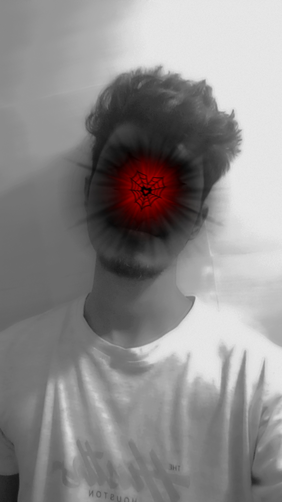

  

  

### 📊 𝗗𝗲𝘃𝗲𝗹𝗼𝗽𝗲𝗿 𝗦𝘁𝗮𝘁𝘀 🦋

  
  

  

### ✨ 𝗙𝗲𝗮𝘁𝘂𝗿𝗲𝘀 🌷

<table align="center">
  <tr>
    <td align="center" width="160">🤖 <b>Smart Commands</b></td>
    <td align="center" width="160">🔁 <b>Auto Failover</b></td>
    <td align="center" width="160">🛡️ <b>Anti-Ban Safe</b></td>
    <td align="center" width="160">🌐 <b>Web Dashboard</b></td>
  </tr>
</table>

### 🖼️ 𝗗𝗮𝘀𝗵𝗯𝗼𝗮𝗿𝗱 𝗣𝗿𝗲𝘃𝗶𝗲𝘄 𝗚𝗮𝗹𝗹𝗲𝗿𝘆 🌸

  
  
  

### 💻 𝗧𝗲𝗰𝗵 𝗦𝘁𝗮𝗰𝗸 🐇

  

### 📬 𝗖𝗼𝗻𝗻𝗲𝗰𝘁 𝘄𝗶𝘁𝗵 𝗗𝗲𝘃𝗲𝗹𝗼𝗽𝗲𝗿 🌸

  
  
  

  

Made with 💖 by <b>Mr.King</b> • Star ⭐ the repo if you like it!

